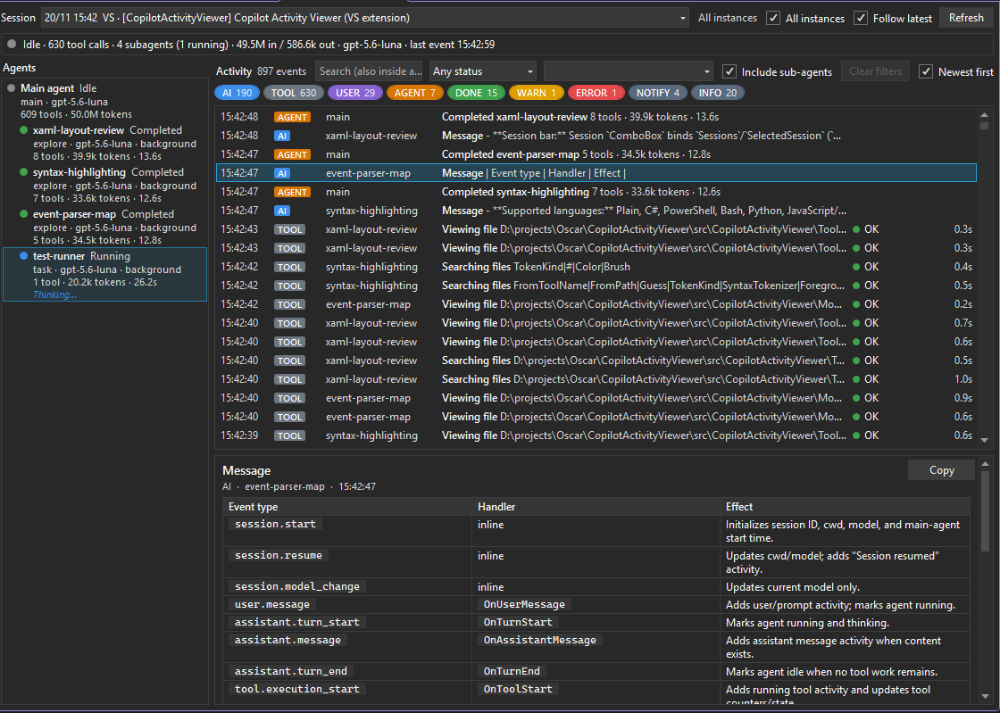
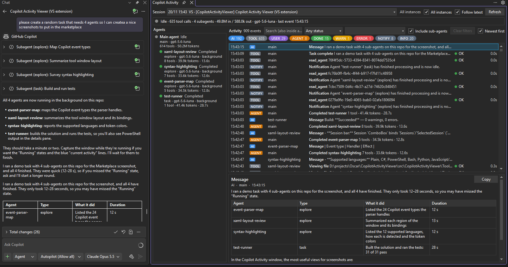

# Copilot Activity Viewer

[](https://github.com/Rabosa616/CopilotActivityViewer/actions/workflows/ci.yml)
[](https://github.com/Rabosa616/CopilotActivityViewer/releases/latest)
[](https://marketplace.visualstudio.com/items?itemName=OscarVaqueroVies.CopilotActivityViewer)
[](LICENSE)
<!-- ALL-CONTRIBUTORS-BADGE:START - Do not remove or modify this section -->
[](#contributors)
<!-- ALL-CONTRIBUTORS-BADGE:END -->

Extension for **Visual Studio 2026** and **SQL Server Management Studio 22** that adds the
**Copilot Activity** window (View > Other Windows > Copilot Activity, or Tools > Copilot Activity)
to see, live, what the GitHub Copilot agent and its sub-agents are doing.





- **Agents**: the main agent and its sub-agents (including nested ones), with status, model,
  tool count, tokens and duration.
- **Timeline**: messages, tool calls (with arguments, result, duration and approvals), errors,
  warnings, skills, compactions and `task_complete`. The most recent activity is shown on top by
  default (*Newest first*). To open long sessions quickly, only the latest 250 activities are
  listed; the *Show older* button loads more.
- **Filters**:
  - by kind (AI, Tool, User, Sub-agent, Skill, Warning, Error…) with colored chips showing the
    count. Click to hide or show a kind; right-click to show only that kind.
  - by status (OK, failed/errors, running, cancelled).
  - by agent, from the drop-down or the agents list, with or without its sub-agents.
  - by free text, which also searches inside arguments and results.
  - the *Clear filters* button resets everything.
- **Formatted details**:
  - scripts and code with syntax highlighting (PowerShell, bash, C#, Python, JS/TS, JSON,
    XML/XAML, SQL, YAML, diff).
  - JSON is pretty-printed.
  - messages from the AI and sub-agents are rendered as markdown (headings, lists, tables,
    code blocks).
  - errors are shown in red.
  - a *Copy* button copies the raw text.

The functional specifications of the window are in [`specs/`](specs/README.md).

## One window per instance

Every Visual Studio and SSMS instance stores its sessions in the same place, but each window
**only shows the sessions of its own instance**:

1. the extension finds the `devenv.exe` / `Ssms.exe` process that hosts it;
2. it finds the `copilot.exe` started by that instance and its log directory (`--log-dir`);
3. it reads those logs incrementally (also across log rotation) to learn which sessions that
   instance serves.

The monitored instance is shown at the top right (e.g. *This Visual Studio (PID 39400)*).
Tick **All instances** to see the sessions of every instance. If no Copilot chat has been
started in that instance yet, the window says so. If the sessions cannot be identified (for
example, if Copilot changes its log format), all of them are shown.

## Technology

- [VisualStudio.Extensibility](https://learn.microsoft.com/visualstudio/extensibility/visualstudio.extensibility/)
  *out-of-process* on **.NET 10**. The extension runs outside the IDE process, so it cannot
  block it or make it crash.
- UI built with **Remote UI**: `ToolWindow\ActivityControl.xaml` (a `DataTemplate` without
  code-behind) bound to `ActivityViewModel`. The details are generated as a XAML `FlowDocument`
  (`DetailsXamlBuilder`).
- `System.Text.Json` to read the `events.jsonl` files.

The window incrementally reads the `events.jsonl` files under
`%LOCALAPPDATA%\Microsoft\VisualStudio\CopilotCli\session-state` (and the equivalent folders of
SSMS, other hosts and `%USERPROFILE%\.copilot\session-state`). This format is internal to
Copilot and may change; the reader ignores unknown events and fields. Nothing is sent anywhere.

## Build and test

Requires the .NET 10 SDK or later:

```powershell
dotnet build CopilotActivityViewer.slnx -c Release
dotnet test CopilotActivityViewer.slnx -c Release --no-build
```

The package is written to `src\CopilotActivityViewer\bin\Release\net10.0-windows8.0\CopilotActivityViewer.vsix`.

## Install

Requires Visual Studio 2026 18.12 or later, or SSMS 22.

In Visual Studio, install it from Extensions > Manage Extensions (search for
"Copilot Activity Viewer") or from the
[Visual Studio Marketplace](https://marketplace.visualstudio.com/items?itemName=OscarVaqueroVies.CopilotActivityViewer).
To install the `.vsix` manually (for example in SSMS):

1. If version 1.x (VSSDK) is installed, uninstall it first from
   Extensions > Manage Extensions.
2. Close the IDE and double-click the `.vsix`. For SSMS you can also use
   `"C:\Program Files\Microsoft SQL Server Management Studio 22\Release\Common7\IDE\VSIXInstaller.exe" CopilotActivityViewer.vsix`.

The `.vsix` of every version can be downloaded from
[Releases](https://github.com/Rabosa616/CopilotActivityViewer/releases).

## Publishing

Everything is automated with GitHub Actions:

- **CI** (`.github/workflows/ci.yml`): on every push to `master` and every pull request it
  builds, runs the tests and uploads the `.vsix` as an artifact.
- **Release** (`.github/workflows/release.yml`): when a `vX.Y.Z` tag is pushed, it builds that
  version, runs the tests, creates the GitHub release with the `.vsix` and, if the
  `VS_MARKETPLACE_PAT` secret exists, publishes it to the Visual Studio Marketplace with
  `VsixPublisher.exe` (from the `Microsoft.VSSDK.BuildTools` NuGet package).

```powershell
git tag v2.1.0
git push origin v2.1.0
```

One-time Marketplace setup:

1. Create a *publisher* at <https://marketplace.visualstudio.com/manage> with the ID `oscarvaquerovies`
   and the display name `Oscar Vaquero Viñes` (it must match `publisherName` in
   `CopilotActivityViewerExtension.cs`; if you choose other values, update that file and
   `marketplace/publishManifest.json`).
2. Create a *Personal Access Token* at <https://dev.azure.com> with **All accessible
   organizations** and the **Marketplace > Manage** scope. You need an Azure DevOps
   organization to reach the token page (create one at <https://aex.dev.azure.com/me>).
   Azure DevOps is retiring global PATs on 27 January 2027, so this token will stop working
   on that date.
3. Store it as a repository secret:
   `gh secret set VS_MARKETPLACE_PAT --repo Rabosa616/CopilotActivityViewer`.

Without the secret, publish manually: download the `.vsix` from the GitHub release, open
<https://marketplace.visualstudio.com/manage/publishers/oscarvaquerovies>, choose
**New extension > Visual Studio** and upload it. To publish a later version, choose
**Update** on the existing extension.

The Marketplace page is generated from `marketplace/overview.md` and
`marketplace/publishManifest.json`. The Marketplace publishes the extension for Visual Studio;
for SSMS, install the `.vsix` from the release as described in [Install](#install).

## Contributing

Issues and pull requests are welcome. Read the [Contributing guide](CONTRIBUTING.md) and the
[Code of Conduct](CODE_OF_CONDUCT.md) before you start. All documentation, specs, code comments
and UI text are in English.

Please report security vulnerabilities privately, as described in the
[Security Policy](SECURITY.md).

## Contributors

Thanks goes to these wonderful people ([emoji key](https://allcontributors.org/docs/en/emoji-key)):

<!-- ALL-CONTRIBUTORS-LIST:START - Do not remove or modify this section -->
<!-- prettier-ignore-start -->
<!-- markdownlint-disable -->
<table>
  <tbody>
    <tr>
      <td align="center" valign="top" width="14.28%"><a href="https://github.com/Rabosa616"><br /><sub><b>Oscar Vaquero Viñes</b></sub></a><br /><a href="https://github.com/Rabosa616/CopilotActivityViewer/commits?author=Rabosa616" title="Code">💻</a> <a href="https://github.com/Rabosa616/CopilotActivityViewer/commits?author=Rabosa616" title="Documentation">📖</a> <a href="#design-Rabosa616" title="Design">🎨</a> <a href="#ideas-Rabosa616" title="Ideas, Planning, & Feedback">🤔</a> <a href="#maintenance-Rabosa616" title="Maintenance">🚧</a> <a href="https://github.com/Rabosa616/CopilotActivityViewer/commits?author=Rabosa616" title="Tests">⚠️</a></td>
    </tr>
  </tbody>
</table>

<!-- markdownlint-restore -->
<!-- prettier-ignore-end -->

<!-- ALL-CONTRIBUTORS-LIST:END -->

This project follows the [all-contributors](https://github.com/all-contributors/all-contributors)
specification. Contributions of any kind are welcome! See also [AUTHORS](AUTHORS.md).

## License

[MIT](LICENSE)
